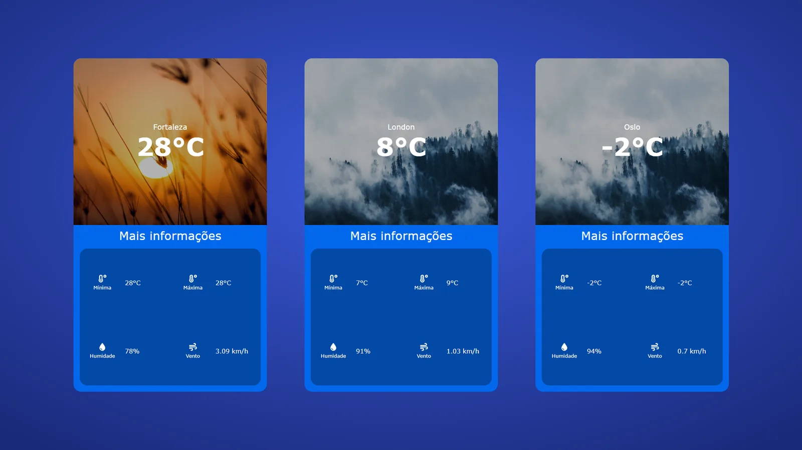

# App de Clima em Angular

Clima atual de qualquer cidade com a API do OpenWeatherMap.

<p align="center">
  
</p>

---

## Sumário

- [Visão geral](#visão-geral)
- [Telas](#telas)
- [Stack e versões](#stack-e-versões)
- [Estrutura do projeto](#estrutura-do-projeto)
- [Primeiros passos](#primeiros-passos)
- [Configuração](#configuração)
- [Scripts](#scripts)
- [Autor](#autor)

---

## Visão geral

Aplicação em Angular 15 que consulta a API pública do OpenWeatherMap e mostra o clima atual da cidade buscada: temperatura, mínima, máxima, umidade e vento, com uma imagem de fundo que muda conforme a temperatura. Organizada em módulo, página, componente de card e serviço HTTP com RxJS.

Principais funcionalidades:

- Busca de clima por cidade
- Integração com API REST pública
- Imagem que muda conforme a temperatura

Concluído em 06/2024.

---

## Telas

Telas com dados reais da API do OpenWeatherMap.

<table>
  <tr>
    <td width="50%"><br><sub>Fortaleza em um dia de sol</sub></td>
    <td width="50%"><br><sub>Londres</sub></td>
  </tr>
  <tr>
    <td width="50%"><br><sub>Oslo com frio</sub></td>
  </tr>
</table>

---

## Stack e versões

| Categoria | Tecnologia | Versão |
| --- | --- | --- |
| Linguagem | TypeScript | 4.9 |
| Framework | Angular | 15.2 |
| Build | Angular CLI | 15.2 |
| Reatividade | RxJS | 7.8 |
| Ícones | Font Awesome | 0.12 |
| Testes | Jasmine + Karma | 4.5 / 6.4 |
| Qualidade | Prettier | 3.3 |

As versões exatas estão no `package.json`.

---

## Estrutura do projeto

```
src/
  app/
    models/
    modules/
    app-routing.module.ts
    app.component.html
    app.component.scss
    app.component.spec.ts
    app.component.ts
    app.module.ts
  assets/
    cold1.jpg
    cold2.jpg
    raining.jpg
    sun.jpg
  environments/
    environment.example.ts
  favicon.ico
  index.html
  main.ts
  styles.scss
```

---

## Primeiros passos

### Pré-requisitos

- Node.js 16 ou mais recente (o Angular 15 pode avisar em versões novas do Node, mas roda)
- npm

### Instalação

```bash
git clone https://github.com/marcospsdev/Weather-App-in-Angular.git
cd Weather-App-in-Angular
npm install
npm start                 # http://localhost:4200
```

---

## Configuração

A chave do OpenWeatherMap fica em `src/environments/environment.ts`, que está no `.gitignore`:

1. Crie uma chave gratuita em [openweathermap.org](https://openweathermap.org/api).
2. Copie `src/environments/environment.example.ts` para `src/environments/environment.ts` e coloque a sua chave em `openWeatherApiKey`.

---

## Scripts

| Comando | Descrição |
| --- | --- |
| `npm start` | Servidor de desenvolvimento em http://localhost:4200 |
| `npm run build` | Build de produção em `dist/` |
| `npm run watch` | Build em modo watch |
| `npm test` | Testes unitários |

---

## Autor

**Marcos Paulo** · Desenvolvedor Full-Stack

- LinkedIn: [in/marcospsdev](https://www.linkedin.com/in/marcospsdev)
- GitHub: [@marcospsdev](https://github.com/marcospsdev)
